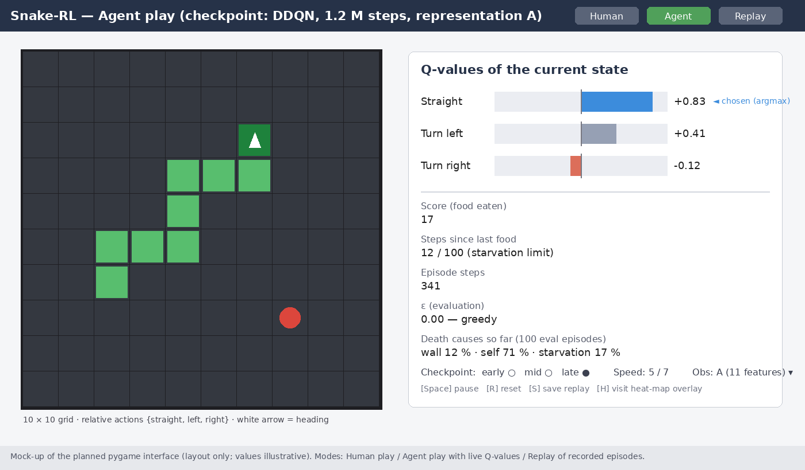

**43008: Reinforcement Learning**

**Assignment 3, Part-B:  
Design, Development/Implementation Plan**

**Project Title and number (Refer to Dashboard):**

**Value-Based Deep Reinforcement Learning on Snake: A Controlled Study of State Representation, Reward Design, and DQN Stabilisation**

Project number: **48**

**Team Name:**

**The Deadly Triad**

**Team Members:**

| **Student Name** | **Student ID** | **Email ID**                    |
|------------------|----------------|---------------------------------|
| Yue Liu          | 25211451       | Yue.Liu-14@student.uts.edu.au   |
| Jiahao Liu       | 14191136       | Jiahao.Liu-4@student.uts.edu.au |
| Siqin Jin        | 26145324       | siqin.jin@student.uts.edu.au    |

**Dataset/Environment Details (Optional, if available/planned):**

No external dataset is used: all training data are generated by interaction with a Snake environment that we implement ourselves (Python/NumPy, Gymnasium-compatible reset()/step() API). The code repository (GitHub) will be linked in the Part-C submission once the environment is released. Planned specification:

> • **Grid.** 10 × 10 as the main setting; 8 × 8 for debugging and 16 × 16 for an extension experiment (difficulty knob).
>
> • **Actions.** Relative actions {straight, turn left, turn right}: three actions, which exclude the illegal 180° reversal by construction. Absolute four-direction actions are kept as an ablation.
>
> • **Dynamics and termination.** The snake moves one cell per step and grows when it eats. An episode ends on wall collision, self-collision, or starvation truncation (100 consecutive steps without food); the three causes are logged separately. Food re-spawns uniformly at random on an empty cell, so a policy has to generalise rather than memorise a board.
>
> • **Observations (two selectable modes, the first experimental axis).** (A) an 11-dimensional binary feature vector — danger straight/left/right (3), heading one-hot (4), food direction (4) — for an MLP; (B) a multi-plane 10 × 10 grid (head, body, food, heading plane) for a CNN. A single grid frame without heading information is not Markov: the next state cannot be predicted without the direction of travel. The heading plane (alternatively frame stacking) restores the Markov property, and this design decision is documented in the report.
>
> • **Rewards (selectable by configuration, the second experimental axis).** R0 sparse: +1 food, −1 death, 0 otherwise. R1: R0 plus a −0.01 step penalty. R2: R0 plus potential-based shaping F = γΦ(s′) − Φ(s) with Φ = −(normalised distance to food), the only shaping form that provably preserves the optimal policy. R3: naive distance shaping (+0.01 closer, −0.01 farther), included deliberately to expose reward hacking.
>
> • **Vectorised implementation.** N = 128–256 boards are simulated as one (N, 10, 10) tensor with vectorised movement and collision checks, so a single network forward pass serves all boards; throughput of the Python step loop is the real bottleneck, not the GPU.
>
> • **Reference players shipped with the environment.** Random; greedy A\* (shortest path to food, ignores self-trapping); Hamiltonian-cycle player (near-perfect but slow upper bound). They fix the coordinate system in which the learned agents are judged.

**Interface/Deployment platform and plan:**

**Type.** Software environment on a local workstation; no robot or embedded device. Training runs on Python 3.11 with PyTorch 2.7+ / CUDA 12.8 on an RTX 5090, with a CPU fallback for small configurations. The code is delivered as a repository plus a Colab/IPython notebook that reproduces the main figures from saved checkpoints.

**GUI.** A pygame application (mock-up in Figure 1) with three modes. (1) Human play: keyboard control of the same environment used for training. (2) Agent play: a selected checkpoint plays live while a side panel shows a bar chart of the three Q-values, the chosen action, the current score, steps since the last food (against the starvation limit) and the running death-cause statistics, so that the viewer can see what the agent is “thinking”. (3) Replay: recorded episodes from early/mid/late training checkpoints and, if observed, a reward-hacking case. The panel also switches checkpoint, observation mode (A/B) and playback speed, and can overlay a visit heat-map.

**Demonstration plan (Parts D and F).** (i) three short recordings — early (random-looking), middle (eats reliably), late (avoids trapping itself); (ii) the examiner plays for one minute, then the agent plays the same seeded board; (iii) one decision is explained live from the Q-value panel; (iv) a reward-hacking clip if one is captured.

*Figure 1. Mock-up of the planned pygame interface (agent-play mode): board on the left, live Q-values, statistics and controls on the right. Layout only; values are illustrative.*

**Implementation plan:**

**Techniques and methods (phased; each phase gates the next).**

> • **Phase 0 —** Environment, vectorisation, unit tests, non-learning baselines (random, A\*, Hamiltonian).
>
> • **Phase 1 — Tabular Q-learning** on the 11-feature state (≈2¹¹ states fit in a table): tunes the ε schedule, α and γ without neural-network confounders and gives the “before function approximation” reference point.
>
> • **Phase 2 — DQN core:** experience replay + target network; MLP for representation A, CNN for representation B. Component ablation: full / −replay / −target / −both (four curves) to connect observed instability with the deadly triad (function approximation + bootstrapping + off-policy learning).
>
> • **Phase 3 — Refinements:** Double DQN (with the mean max-Q versus realised-return overestimation measurement logged throughout training), Dueling architecture, prioritised experience replay. Scope rule: three refinements with full ablations rather than more refinements without ablations.

**Training strategy.**

> • **Initial hyper-parameters.** γ = 0.99; ε-greedy with linear decay 1.0 → 0.05 over the first 10–20 % of steps, ε = 0 at evaluation; replay buffer 100 k transitions; batch 256 sampled from 128–256 parallel environments; Adam, learning rate 2.5 × 10⁻⁴; Huber loss; target network synchronised every 1–2 k gradient steps (itself an ablation variable); gradient-norm clipping at 10. Values are starting points and will be tuned on the 8 × 8 debug grid first.
>
> • **Budget.** 1–2 M environment steps per run on 10 × 10; five random seeds per configuration; overnight batch runs on the workstation.
>
> • **Evaluation protocol.** Every N training steps the network is frozen and 100 greedy episodes are played; all reported curves are evaluation curves with mean and 95 % confidence interval over seeds; training returns are logged but are not used as evidence. Metrics: mean score (food eaten), score distribution (box plots), survival steps, death-cause breakdown (wall / self / starvation) over training, and for DQN versus Double DQN the Q-overestimation gap. Behaviour analysis: visit heat-maps, last-steps trajectory replays, reward-hacking cases.
>
> • **Experiment matrix.** State representation A vs B; rewards R0–R3; ablations ±replay ±target; DQN / Double DQN / Dueling / PER; hyper-parameter sensitivity (ε schedule, buffer size, target period, γ); action space 3 vs 4. Rows may be cut if time runs short; five seeds and confidence intervals per row are never cut.

**Testing plan.**

> • **Environment unit tests (pytest).** Wall and self collision; growth on eating; food never spawns on the snake; starvation truncation at exactly 100 steps; reward invariants per variant (e.g. R2 telescopes to R0 plus a constant over an episode); the vectorised environment equals the single environment step by step for the same seed; Markov check — the same grid with different headings gives different observations.
>
> • **Learner sanity checks.** Tabular Q-learning must clearly beat the random player on 8 × 8 within minutes; DQN on representation A must match tabular Q-learning on the same features; loss and Q-value magnitudes are monitored; every configuration gets a short single-seed smoke run before a batch is launched.
>
> • **Baseline sanity.** The Hamiltonian player reaches a near-maximal score; A\* score and death causes behave as expected (dies by trapping itself).
>
> • **Reproducibility.** Fixed seeds for environment, NumPy and PyTorch; requirements.txt; every run logs its configuration, seed and git hash; all result tables and figures are regenerated from the logs by one script.

**Error handling plan.**

> • **Divergence (NaN loss, exploding Q-values).** Huber loss and gradient clipping as prevention; automatic abort on NaN; resume from the last checkpoint with a lower learning rate; scalar logs (loss, mean Q, evaluation score) inspected per run.
>
> • **CNN line fails to converge by Week 8.** Pre-agreed fallback: the main line becomes representation A with the full reward and ablation study; the CNN becomes a negative-result section with a diagnosis (sample efficiency, Markov violation, capacity).
>
> • **Reward hacking or looping behaviour.** Starvation truncation prevents infinite loops; hacking cases are recorded and reported as findings, not treated as bugs.
>
> • **Environment bugs.** Invariant assertions in debug mode on every step; the vectorised/single-environment equivalence test runs in CI.
>
> • **Hardware and software.** CUDA/driver mismatch → CPU or Colab fallback for small configurations; checkpoints every M steps so an interrupted overnight batch resumes; all runs are scripted with no manual steps.
>
> • **Time overrun.** Experiment-matrix rows are dropped in a pre-agreed order (action space → hyper-parameter sensitivity → PER); seeds are never dropped.

**Tentative timeline** (session weeks).

| **Period**     | **Milestone**                                                                                                                                  |
|----------------|------------------------------------------------------------------------------------------------------------------------------------------------|
| Week 7         | Environment + unit tests + vectorisation; A\*/Hamiltonian baselines; tabular Q-learning results; first DQN (representation A) evaluation curve |
| Week 8         | DQN with CNN (representation B) running; initial comparison table; repository link (Part C)                                                    |
| Weeks 8–9      | GUI with the three modes; recordings of early/mid/late checkpoints (Part D)                                                                    |
| Weeks 9–11     | Overnight experiment matrix (5 seeds); ablations; Double-DQN overestimation study; Dueling/PER; behaviour-analysis figures                     |
| Week 12 onward | Final report, demonstration rehearsal, oral-defence preparation (Parts E, F, G)                                                                |
